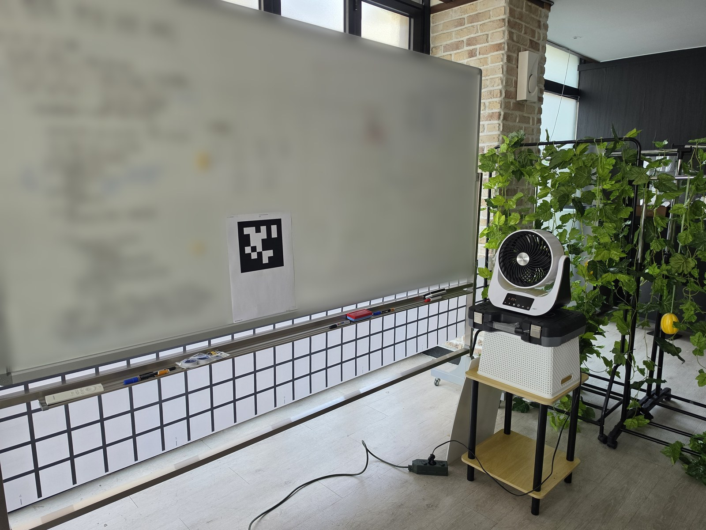
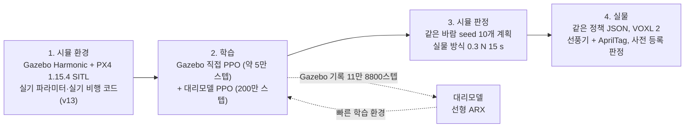
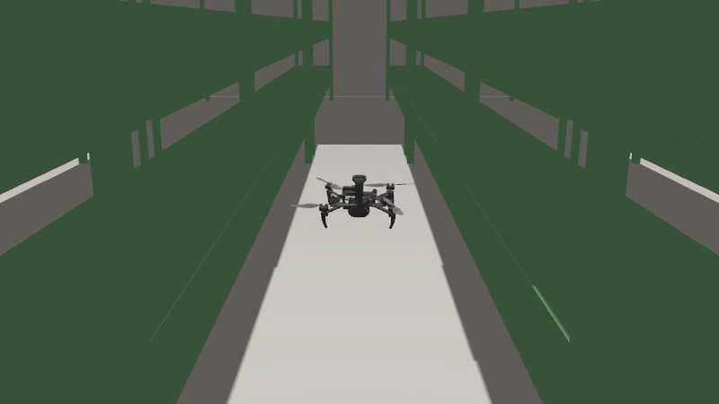
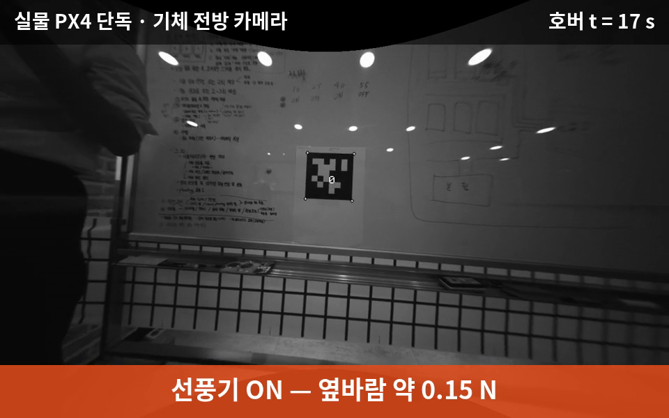
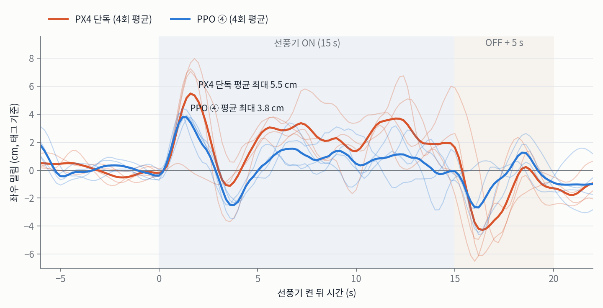

# RL Hover Gust: 옆바람 보정 PPO for Starling 2

%20%7C%203.10%20(train)-blue?logo=python)


-black)

<p align="center">
  
  <br>
  <em>▲ 실물 옆바람 시험 장면. 기체는 화이트보드의 20 cm AprilTag 앞에서 1 m 호버하고, 오른쪽 선풍기가 옆바람을 줍니다</em>
</p>

본 폴더는 [`drone_sim_gz/`](../)의 하위 작업으로, **정지 비행 중 옆바람에 밀리는 거리를 강화학습으로 줄이는 실험**의 코드와 결과를 다룹니다.
Gazebo에서 PPO 정책을 학습하고, **같은 정책 파일을 실물 Starling 2에 올려** 미리 정한 통계 기준으로 효과를 확인했습니다.
PX4는 수정하지 않고, 정책은 PX4에 보내는 **목표 위치만 옆으로 옮깁니다**.

> **이 저장소가 다루는 범위**: 시뮬 학습(Gazebo·대리모델) → 시뮬 판정 → 실물 1회 비교(2026-11-05)까지입니다.
> 실물 결과는 하루·한 선풍기 조건의 결과이며, 비교 상대는 PX4 단독입니다.

---

## 1. Project Overview (프로젝트 개요)

Starling 2(약 300 g)는 실내 식물공장 통로처럼 좁은 곳을 납니다. 옆바람(환기·사람 이동)에 밀리면 재배단에 닿을 수 있어, **1 m 정지 비행 중 동서 방향 외력에 밀리는 최대 거리**를 줄이는 것을 문제로 골랐습니다.

* **Motivation**: Gazebo를 공부한 목적은 시뮬에서 강화학습을 하고 실물에 올리는 것(Sim–RL–Real)이었습니다. 효과가 cm 단위로 바로 보이고, 같은 외력을 시뮬(힘 주입)과 실물(선풍기)에서 줄 수 있으며, PX4 위에서 목표만 옮기므로 안전한 문제를 골랐습니다.
* **Approach**: 저수준 제어는 PX4에 맡기고, 그 위에 10 Hz 학습 정책을 한 층 얹었습니다. 정책 출력은 PX4 목표 위치를 동서 방향으로 옮기는 보정량 δ(±0.2 m, + = 동쪽, − = 서쪽)입니다.
* **Result**: 실물 선풍기 시험에서 최대 밀림 중앙값이 **7.17 → 4.46 cm**(PX4 단독 대비 남은 밀림 62 %, 즉 약 38 % 감소), 사전 등록한 4 대 4 한쪽 정확 순열 검정 **p = 0.0143**. 밀림은 태그 좌우 위치의 1 s 이동평균 최대 절댓값이며 바람 종료 후 5 s(반동 포함)까지 셉니다(5.4).

---

## 2. System Architecture (시스템 구성)

### Pipeline


### Control Structure
```text
[학습 정책 10 Hz]  관측(PX4 추정 e, v, roll, 이력) → MLP 64×64 → δ (±0.2 m, 0.1 m/step 제한)
                                                               │
[실기 비행 코드 v13]  목표 위치 송신기:  target = hover_target + (0, δ, 0)   ← δ만 더함 (ctl_patch.py)
                                                               │
[PX4 1.15.4]        위치 → 자세 → 모터 (수정 없음)
```

### Hardware / Software Stack

| 계층 | 구성 |
|---|---|
| 기체 | ModalAI Starling 2 C26, VOXL 2, 실측 297.5 g, OpenVINS VIO(GPS 없음) |
| 시뮬레이터 | Gazebo Harmonic 8 (`starling-gz` 컨테이너), 인스턴스 1개·실시간 1배속 (공용 서버) |
| 비행 스택 | PX4 v1.15.4 SITL + 실기 파라미터, MAVSDK-Python 0.12.0 / Python 3.6.9 (실기와 같음) |
| 강화학습 | Stable-Baselines3 2.3.2 PPO, PyTorch(CPU), Gymnasium |
| 정책 실행기 | 정책 = JSON 가중치 1개, 실행기 = 순수 Python 3.6 표준 모듈 (시뮬·실물 같은 코드) |
| 실물 기준값 | 20 cm AprilTag(전방 트래킹 카메라) + PX4 기수. VIO는 정책 입력과 겹쳐 기준값에서 제외 |

<p align="center">
  
  <br>
  <em>Figure. Gazebo Harmonic 식물공장 통로에서 비행하는 Starling 2 모델(추적 카메라 화면). 옆바람 학습·평가는 같은 기체 모델로 빈 월드에서 했습니다</em>
</p>

---

## 3. RL Formulation (강화학습 문제 구성)

모든 정책이 같은 관측·행동·보상을 씁니다. **관측은 PX4 추정값만**, **보상은 시뮬 정답값으로** 계산합니다(정답값은 정책 입력에 들어가지 않음). 정의: [`rl_demo/policy_runtime.py`](rl_demo/policy_runtime.py), 설정: [`config/hover_gust_rl_wide.json`](config/hover_gust_rl_wide.json).

### 3.1 Observation (관측, 8차원, 10 Hz)

$$
o_t = \left[\frac{e_t}{0.1},\ \frac{v_t}{0.3},\ \frac{\phi_t}{10},\ \frac{\delta_{t-1}}{0.2},\ \frac{e_{t-1}}{0.1},\ \frac{v_{t-1}}{0.3},\ \frac{e_{t-2}}{0.1},\ \frac{v_{t-2}}{0.3}\right]
$$

| 기호 | 뜻 | 단위 |
|---|---|---|
| $e$ | 동서 위치 오차 (PX4 추정 − 호버 목표, + = 동쪽) | m |
| $v$ | 동서 속도 (PX4 추정, + = 동쪽) | m/s |
| $\phi$ | roll (기체가 북쪽을 보므로 동서 방향 기울기) | ° |
| $\delta_{t-1}$ | 직전 보정량 (+ = 동쪽, − = 서쪽) | m |

첫 스텝은 과거 칸을 현재 값으로 채웁니다.

### 3.2 Action (행동)

$$
a = \mathrm{clip}(a_{\mathrm{raw}}, -1, 1), \qquad \delta^{*} = 0.2\,a\ [\mathrm{m}]
$$

$$
\delta_t = \delta_{t-1} + \mathrm{clip}\left(\delta^{*} - \delta_{t-1},\ -0.1,\ 0.1\right)
$$

δ는 부호가 있어 외력 반대쪽으로 목표를 옮기는 것이 기대 응답입니다: 동쪽으로 미는 외력(+F, 기체가 동쪽으로 밀림)에는 서쪽 보정(−δ), 서쪽으로 미는 외력(−F)에는 동쪽 보정(+δ). (풍향 이름으로는 서풍이 동쪽으로 밉니다.) 학습 중에는 $a_{\mathrm{raw}} \sim \mathcal{N}(\mu, \sigma)$, 배포 때는 평균 $\mu$(결정적)를 씁니다.

### 3.3 Reward (보상, 시뮬 정답값)

$$
r_t = -\left[\left(\frac{e^{\mathrm{true}}}{0.05}\right)^2 + 0.1\left(\frac{v^{\mathrm{true}}}{0.3}\right)^2 + 0.02\left(\frac{\delta}{0.2}\right)^2 + 0.05\left(\frac{\Delta\delta}{0.1}\right)^2\right]\Delta t, \qquad \Delta t = 0.1\ \mathrm{s}
$$

| 항 | 뜻 | 가중 |
|---|---|---|
| 위치 오차 | 정답 동서 오차(구간 평균), 5 cm로 정규화 | 1 |
| 속도 | 정답 동서 속도, 0.3 m/s로 정규화 | 0.1 |
| 보정 크기 | 불필요한 보정 억제 | 0.02 |
| 보정 변화 | 떨림 억제 | 0.05 |
| 종료 | 추정 $\lvert e \rvert > 0.5$ m면 회차 종료, 벌점 −10. 40 s를 채우면 가치로 부트스트랩 | −10 |

### 3.4 Wind Distribution (학습 바람)
* 회차 40 s, 앞 6 s·뒤 10 s는 바람 없음, 돌풍 1–3개, 간격 5 s 이상
* 세기 0.03–0.6 N **로그 균등**, 방향은 **동·서 반반**
* 길이: 절반 1–3 s 펄스, 절반 5–12 s 지속풍(선풍기형)
* 외력은 gz ApplyLinkWrench로 몸체에 직접 (난류·후류 없음)

### 3.5 PPO Settings

| 항목 | 값 |
|---|---|
| 신경망 | 정책·가치 각 MLP 64×64, Tanh, $\log\sigma_0 = -2$ |
| 최적화 | 학습률 3e-4, γ 0.99, GAE λ 0.95, clip 0.2, 엔트로피 0, 10 에포크, 배치 200 |
| Gazebo 학습 | 업데이트 1회 = 비행 3회(1200스텝), 42회 ≈ 5만 스텝, 약 2.3시간. 비행 중 정책 고정, 착륙 후 업데이트 |
| 대리모델 학습 | 환경 8개 × 400스텝 롤아웃, 200만 스텝(약 17분), seed 1–3 |

---

## 4. Policies (정책별 조건)

기법을 하나씩 더하며 비교했습니다. **실물 비교에 쓴 정책은 ④입니다.**

| 정책 | 파일 | 학습 환경 | 학습량 | PD 모방 시작 | 무작위화 | 비고 |
|---|---|---|---|:---:|:---:|---|
| PX4 단독 | — | — | — | — | — | δ = 0, 기준선 |
| PD 보정 | `pd_imit.json` | 대리모델 | 모방만 | — | × | 모방 단계만 거친 정책 |
| ① Gazebo 직접 | `gz_wide_s1_v042.json` | Gazebo | ≈ 5만 스텝 | × | × | 실시간이라 수렴 전 |
| ② + 대리모델 | `sur_scratch_s2.json` | 대리모델 | 200만 스텝 | × | × | 처음부터 PPO |
| ③ + PD 모방 | `sur_bc_s3.json` | 대리모델 | 200만 스텝 | ○ | × | 기본 조건 보상 최고 |
| **④ + 무작위화** | **`sur_bcrand_s2.json`** | 대리모델 | 200만 스텝 | ○ | ○ | **실물 적용** |

<details>
<summary><b>PD 모방 시작 (③ ④)</b></summary>

* 전문가: $\delta = -1.5\,e - 0.3\,v$ (PX4 추정값). kp·kd는 대리모델에서 탐색한 값
* 대리모델에서 240회차 수집. 실제 행동엔 잡음 σ 0 / 0.1 / 0.3을 번갈아 섞고, 정답 라벨은 전문가 행동(DAgger 방식)
* 손실 = 행동 MSE + 0.01 × 가치 MSE (가치는 전문가 할인 누적 보상), Adam 1e-3, 30 에포크
* 이후 모방 손실 없이 PPO만 학습 (모방 → PPO 차례로)
* 코드: [`surrogate/train_sur.py`](surrogate/train_sur.py) `bc_warm_start`
</details>

<details>
<summary><b>무작위화 (④, 회차마다 새로 뽑음)</b></summary>

| 항목 | 범위 | 흉내 내는 것 |
|---|---|---|
| `gain_F` 외력 배율 | 0.7–1.3 | 질량·항력·힘 불확실성 |
| `gain_d` δ 입력 배율 | 0.8–1.2 | PX4 추종 응답 차이 |
| `noise_k` 잔차 잡음 배율 | 0.5–2.0 | 난류·센서 떨림 |
| `obs_noise` 관측 잡음 | 위치 3 mm, 속도 0.01 m/s, roll 0.3° | 추정 잡음 |
| `obs_delay` 관측 지연 | 0–1 스텝 | 통신·추정 지연 |
| `F_fluct` 바람 요동 | 20 %, 0.5 s 상관(OU) | 선풍기 바람 흔들림 |
| `F_ramp_s` 돌풍 램프 | 0–1 s | 바람이 서서히 켜지고 꺼짐 |
</details>

<details>
<summary><b>대리모델 (Surrogate)</b></summary>

* 데이터: Gazebo PPO 학습 기록 297회차·11만 8800스텝(학습), 84회차·3만 3600스텝(검증), 10 Hz 격자
* 모델: 선형 ARX, 지연 5스텝(0.5 s). 상태 [추정 위치·속도·roll, 정답 위치·속도], 입력 [δ, 외력], 잔차는 가우시안 잡음으로 재현

$$
s_{j+1} = \sum_{l=0}^{4}\left(A_l\, s_{j-l} + B_l\, \delta_{j-l} + C_l\, F_{j-l}\right) + c + w_j
$$

* 검증: 한 스텝 R² 위치 0.9997, 속도 0.986–0.988, roll 0.989. PX4 단독 밀림/외력 대리 0.4048 대 Gazebo 0.4038 m/N
* 한계: 바람이 그친 뒤 회복을 Gazebo보다 14–35 % 낙관적으로 예측 → 학습용으로만 쓰고 판정은 Gazebo
* 코드: [`surrogate/build_dataset.py`](surrogate/build_dataset.py), [`surrogate/sysid.py`](surrogate/sysid.py), [`surrogate/env.py`](surrogate/env.py)
</details>

---

## 5. Results (결과)

### 5.1 Simulation: 같은 바람 seed 비교 (Gazebo 정답 위치 기준)

학습에 쓰지 않은 돌풍 seed 10개(950000–950009)와 무외란 seed 3개(955000–955002)를 제어기마다 같은 계획으로 비행했습니다. 이륙 준비 시점에 PX4 heading과 정답 heading 차이가 3°를 넘은 회차는 무효로 뺐습니다(빠진 seed가 제어기마다 다름).

**(a) 공통 유효 seed만 집계 (짝지은 비교)** — 6개 제어기가 모두 유효한 돌풍 seed 7개(950000, 950001, 950004, 950006–950009)와 무외란 seed 2개(955000, 955002)

| 제어기 | 돌풍 밀림/외력 (m/N, \|F\| ≥ 0.15 N, 돌풍 5개 평균) | 전체 돌풍 (m/N, 10개 평균) | 바람 없을 때 좌우 RMS (cm, 2회 평균) |
|---|---:|---:|---:|
| PX4 단독 | 0.396 | 0.499 | 1.127 |
| PD 보정 | 0.177 | 0.279 | 0.653 |
| ① Gazebo 직접 | 0.373 | 0.387 | 0.417 |
| ② + 대리모델 | 0.140 | 0.320 | 0.515 |
| ③ + PD 모방 | 0.120 | 0.338 | 0.450 |
| **④ + 무작위화** | **0.179** | **0.356** | **0.447** |

**(b) 제어기별 유효 회차 전부 집계 (짝짓지 않음)**

| 제어기 | 돌풍 계획/유효/무효 | 밀림/외력 (\|F\| ≥ 0.15 N) | 전체 돌풍 | 무외란 계획/유효 | 좌우 RMS (cm) |
|---|---:|---:|---:|---:|---:|
| PX4 단독 | 10/9/1 (950002) | 0.393 (n=7) | 0.472 | 3/3 | 1.179 |
| PD 보정 | 10/9/1 (950003) | 0.175 (n=7) | 0.266 | 3/3 | 0.753 |
| ① Gazebo 직접 | 10/9/1 (950005) | 0.369 (n=7) | 0.375 | 3/2 | 0.417 |
| ② + 대리모델 | 10/8/2 (950002, 950005) | 0.138 (n=6) | 0.298 | 3/2 | 0.515 |
| ③ + PD 모방 | 10/9/1 (950002) | 0.118 (n=7) | 0.288 | 3/3 | 0.379 |
| **④ + 무작위화** | **10/9/1 (950002)** | **0.169 (n=7)** | **0.314** | **3/3** | **0.513** |

밀림/외력은 돌풍 1개마다 (최대 좌우 이탈 / 외력 크기)를 구해 평균한 값, RMS는 회차별 값의 평균입니다. 큰 외력(≥ 0.15 N) 돌풍은 (a)에서 5개뿐이라 순위는 참고용입니다. 큰 외력 기준 순서는 (a) ③ < ② < PD < ④, (b) ③ < ② < ④ < PD로 PD와 ④의 차이(0.002–0.006)는 집계 방식에 따라 뒤집힙니다. 작은 외력까지 넣으면 두 집계 모두 PD가 가장 작습니다. 원자료: [`results/compare_all.txt`](results/compare_all.txt)(b), [`results/compare_common6.txt`](results/compare_common6.txt)(a).

### 5.2 Simulation: 실물 방식 시험 (실물과 같은 실행기, 0.3 N 15 s)

| 정책 | 최대 밀림 (cm) |
|---|---:|
| PX4 단독 | 12.0 |
| ① Gazebo 직접 | 11.0 |
| ② + 대리모델 | 4.6 |
| ③ + PD 모방 | 8.3 (진동) |
| **④ + 무작위화** | **5.4** |

③은 바람 뒤 보정이 ±20 cm 한계를 오가며 진동해 실물 비교에서 제외했습니다.

### 5.3 Why ④: 관측 지연에 대한 견딤 (대리모델)

| 정책 | 기본 조건 보상 | 관측 지연 0–1스텝 보상 |
|---|---:|---:|
| ② | −0.77 | −74.31 |
| ③ | −0.77 | −200.91 |
| **④** | — | **−2.08** |

무작위화 없는 정책을 무너뜨린 요인은 관측 지연이었습니다(외력 ±30 %·응답·잡음·요동·램프는 −0.8 → −1.7 이내). 실물에는 VIO 지연이 있어 ④를 골랐습니다.

### 5.4 Real Flight (2026-11-05)

<p align="center">
  
  <br>
  <em>Figure. 실물 PX4 단독 1 m 호버, 기체 전방 트래킹 카메라. 화면 가운데 20 cm AprilTag. 화면상 태그 이동에는 기체 자세·원근 영향이 섞여 있어 픽셀 이동을 그대로 거리로 읽을 수 없음(판정은 태그 위치 추정값으로 함)</em>
</p>

**조건**: 1 m 호버 40 s, 약 8 s에 선풍기 ON, 15 s 뒤 OFF(바람 힘 약 0.15 N). PX4 단독과 PPO ④를 번갈아 4회씩.
**지표**: 선풍기 ON부터 OFF + 5 s까지, 외력 전 영점을 뺀 태그 좌우 위치(태그 translation + PX4 heading, 1 s = 5표본 이동평균)의 최대 절댓값. 순간 최대 이탈이나 충돌 여유를 잰 값이 아닙니다. PPO 2회(062849, 063717)는 최대값이 선풍기 OFF 약 1.2–1.5 s 뒤, PX4와 반대 부호로 나와 바람 종료 뒤 반동이 지표에 포함됐습니다. 지표·무효 기준·검정은 비행 전에 [`real/EVAL_METRIC.md`](real/EVAL_METRIC.md)에 고정.

| 세트 | PX4 단독 (cm) | PPO ④ (cm) |
|---|---:|---:|
| 1 | 6.90 | 4.48 |
| 2 | 7.27 | 4.08 |
| 3 | 7.97 | 4.45 |
| 4 | 7.08 | 4.69 |
| **중앙값** | **7.17** | **4.46** |

* 4 대 4 완전 분리 → 한쪽 정확 순열 검정 **p = 0.0143 < 0.025** (1차 판정에서 유의)
* 8회 모두 정상 종료, 보정 해제 0회. PPO 보정과 추정 위치 오차의 상관 −0.76 ~ −0.83
* 바람 없는 안정 구간 흔들림은 PX4 0.51 cm, PPO 0.51 cm로 같음

<p align="center">
  
  <br>
  <em>Figure. 선풍기 켠 시각 = 0. 굵은 선 4회 평균, 연한 선 각 비행(판정 지표와 같은 1 s 평활 태그 좌우 위치). 평균 곡선의 최대(5.5 / 3.8 cm)는 비행마다 최대 시각이 달라 표의 비행별 최대 중앙값(7.17 / 4.46 cm)보다 작습니다. 그림 스크립트: real/plot_mean_traces.py</em>
</p>

---

## 6. Directory Structure (디렉토리 구조)

```text
rl_hover_gust/
├── config/hover_gust_rl_wide.json  # 과제 설정: 바람 분포, δ 한계, 보상 가중, 종료 조건
├── rl_demo/                        # [Shared] 시뮬·실물 공통 (Python 3.6, 표준 모듈만)
│   ├── policy_runtime.py           #   관측·행동·보상 정의, 순수 Python MLP 정책
│   ├── contracts.py                #   설정 로드, 돌풍 일정 생성
│   └── hover_metrics.py            #   밀림·복귀 시간 등 지표
├── experiments/                    # [Gazebo] 실시간 학습·평가
│   ├── train_hover_gust.py         #   Gazebo PPO 학습기 (비행 중 고정, 착륙 후 업데이트)
│   ├── eval_hover_gust.py          #   비교 계획 생성 (--make-plan)
│   └── split_eval_plan.py          #   계획을 부팅 1회 = seed 1개 배치로 분할
├── scripts/                        # [Gazebo] 배치 실행 (개발 서버 경로·도커 전제)
│   ├── run_eval_batches.sh         #   배치 목록 순서대로 실행
│   ├── hover_gust_run.sh           #   배치 1개 = SITL 1회 부팅 (인스턴스 2)
│   ├── hover_gust_worker.py        #   비행·정책 추론 (starling-flight)
│   ├── gust_scheduler.py           #   돌풍 힘 주입 (gz ApplyLinkWrench)
│   ├── hover_gust_eval.py          #   회차 판정 (summary.json)
│   ├── hg_rc_stat.sh               #   종료 코드 정리
│   └── real_flight_safe.py, safety_patch.py  # [Real] 실물 안전층 (기체 사전 설치)
├── surrogate/                      # [Surrogate] 대리모델 학습·집계
│   ├── build_dataset.py, sysid.py  #   Gazebo 기록 → 10 Hz 데이터셋 → 선형 ARX
│   ├── env.py, sur_common.py       #   Gymnasium 환경 (+ 무작위화), 공용 함수
│   ├── train_sur.py                #   PD 모방 시작 + PPO
│   ├── agg_evsur.py, agg_evsur_common.py  # 5.1 표 (b), (a) 집계
│   ├── model_L5.npz, model_L5_cal.json, data/ds_{train,val}.npy
│   └── selected/                   #   정책 JSON (①–④, PD)
├── real/                           # [Real] 실물 실행·판정
│   ├── ctl_flight.sh, ctl_run.sh, ctl_patch.py, real_ctl_safe.py, hover_*.py/sh, fan_mark.py, mpa_capture.py
│   ├── deploy_ctl.sh               #   기체 tools_safe에 배포 (7개, sha256 비교)
│   ├── VEHICLE_FILES.txt, check_vehicle_files.py  # 기체 파일 17개 목록·정적 대조
│   ├── step2/step2_check.sh, step2/hover_plan_check.py  # 비행 전 점검 (사전 설치)
│   ├── ctl_judge.py, hover_analyze.py, tag_ref.py, tag_step1.py  # 사전 등록 지표·순열 검정
│   ├── EVAL_METRIC.md              #   사전 등록 문서
│   ├── plot_mean_traces.py         #   5.4 그림
│   ├── collect_20261103/…/extrinsics.conf  # 기록 당시 카메라 외부 파라미터
│   └── ctl_20261105/               #   8회 판정 입력, fan_events, judge_look1.json, mean_traces.json
├── results/                        # compare_all.*, compare_common6.*, SHA256SUMS.txt
├── assets/                         # 문서용 이미지
├── requirements.txt
└── README.md
```

---

## 7. How to Run (실행)

> **⚠️ Note**: 이 폴더는 상위 [`drone_sim_gz/README.md`](../README.md) 아래 `drone_sim_gz/rl_hover_gust/`에 둡니다. 대리모델 학습(2)과 실물 판정(5)은 이 폴더만으로 실행됩니다. Gazebo 비교(3)는 개발 서버의 `~/starling_sim/v3_marker` 트리(이 폴더와 같은 상대 경로의 파일 + 도커·SITL 구성 `../v3_marker/scripts/`의 run_wk_instance.sh, px4_param_guard.sh, gt_logger.py 등)에서 실행·집계합니다. 실물 비행(4)은 기체 파일 목록 `real/VEHICLE_FILES.txt`를 전제합니다.

**환경**
* 호스트(학습·판정): Python 3.10, `pip install -r requirements.txt` (개발 환경: numpy 1.26.4, torch 2.3.1+cpu, stable-baselines3 2.3.2, gymnasium 0.29.1).
* 시뮬 비행: 도커 `starling-gz`(PX4 1.15.4 SITL + gz Harmonic, 인스턴스 2)와 `starling-flight`(Python 3.6.9 + MAVSDK 0.12.0, 실기와 동일).
* 기체: VOXL 2, `/data/claude_collect/tools_safe/`의 17개 파일 + 기체 원본 `/home/root/path_flight_phase1_v13.py`(저장소 미포함). 목록·출처·sha256은 `real/VEHICLE_FILES.txt`.

**1. 대리모델 자산** — 포함됨: `surrogate/model_L5.npz`, `surrogate/model_L5_cal.json`(`{"noise_cal": 0.27, "F_cal": 1.055}`), `surrogate/data/ds_train.npy`, `surrogate/data/ds_val.npy` (해시: `results/SHA256SUMS.txt`)
```bash
# 다시 만들 때 (Gazebo 학습 기록 logs/hg_* 필요, 비공개)
python surrogate/build_dataset.py --out surrogate/data/ds_train.npy logs/hg_v2_s1_u* logs/hg_v2wc_s1_u* logs/hg_v2wb_s1_u*    # 297회차
python surrogate/build_dataset.py --out surrogate/data/ds_val.npy logs/hg_v2wc_s2_u00? logs/hg_v2wc_s2_u01? logs/hg_v2wc_s2_u02[0-7]  # 84회차
python surrogate/sysid.py --lags 5 --save surrogate/model_L5.npz      # ds_train.npy / ds_val.npy를 읽음
# model_L5_cal.json(noise_cal, F_cal)은 Gazebo PX4 단독 밀림에 맞춘 보정값 (worklog 2026-11-04)
```

**2. 대리모델 PPO 학습** (CPU, 약 17분)
```bash
python surrogate/train_sur.py --out surrogate/runs/bcrand_s2 --seed 2 --steps 2000000 --bc 1.5,0.3 --rand default
```

**3. Gazebo 같은 바람 비교** (인스턴스 2, 실시간, 부팅 1회 = seed 1개 × 6 제어기, 13부팅) — 모든 명령을 개발 서버 `~/starling_sim/v3_marker`에서 실행. `hover_gust_run.sh`가 그 경로의 `logs/hg_<배치>/`에 쓰고, 실행기의 완료 확인과 집계도 같은 `logs/`를 읽습니다(실행기는 경로가 다르면 시작 전에 멈춤).
```bash
cd ~/starling_sim/v3_marker
# 계획: --policy는 "라벨=경로"를 쉼표로 연결한 한 인자, 경로는 starling-flight 컨테이너 안 경로. --ks ""로 속도 비례 제어기 끔
mkdir -p plans; W=/home/dronesim/workspace/v3_marker/surrogate/selected
python experiments/eval_hover_gust.py --make-plan plans/plan.json --config config/hover_gust_rl_wide.json --ks "" \
    --policy "PD=$W/pd_imit.json,Gazebo v042=$W/gz_wide_s1_v042.json,sur scratch=$W/sur_scratch_s2.json,sur bc=$W/sur_bc_s3.json,sur bcrand=$W/sur_bcrand_s2.json" \
    --seeds 10 --seed-base 950000 --none-seeds 3
# 분할: plans/plan_evsur_g0..g9, n0..n2.json + plans/batches.txt (2026-11-04 고정 순서 계획과 동일함을 확인)
python experiments/split_eval_plan.py plans/plan.json plans --prefix evsur
# 경로 점검만 (SITL 없음): "paths OK ... v3_marker/logs"
CHECK_ONLY=1 bash scripts/run_eval_batches.sh plans
# 실행 (배치마다 logs/hg_<이름>/)
bash scripts/run_eval_batches.sh plans
# 5.1 표: (b) 제어기별 유효 회차, (a) 공통 유효 seed  → 공개 결과는 results/
python surrogate/agg_evsur.py logs/hg_evsur_*
python surrogate/agg_evsur_common.py
```

**4. 실물 비교 비행** (기체에서 사용자가 실행, 창 2개)

기체 `tools_safe`에는 17개 파일이 필요합니다. 7개(ctl 4개, policy_runtime.py, 정책 2개)는 `deploy_ctl.sh`가 보내고, 10개(안전층 real_flight_safe.py·safety_patch.py, step2_check.sh·hover_plan_check.py, 기록·요약 hover_record.py·mpa_capture.py·hover_summary.py·tag_ref.py·tag_step1.py, fan_mark.py)는 미리 설치되어 있어야 합니다. 2026-11-05 비행 기록에 해시가 남은 9개는 이 저장소 파일과 같습니다.
```bash
python3 real/check_vehicle_files.py                                     # 목록 대조 (SSH·비행 없음): 참조·import·sha256
KH=<known_hosts 파일> bash real/deploy_ctl.sh                         # 호스트 → 기체 tools_safe (7개)
bash /data/claude_collect/tools_safe/ctl_flight.sh ppo 1.0 40          # 창 1 (VOXL), 또는 px4
python3 /data/claude_collect/tools_safe/fan_mark.py                    # 창 2 (VOXL, 이륙 전): Enter로 선풍기 ON/OFF 기록
```

**5. 실물 판정** (포함된 8회 기록으로 바로 재현)
```bash
cd real/ctl_20261105
python ../ctl_judge.py ctl_px4_20261105_062643 ctl_ppo_20261105_062849 ctl_px4_20261105_063015 ctl_ppo_20261105_063140 \
    ctl_px4_20261105_063303 ctl_ppo_20261105_063424 ctl_px4_20261105_063548 ctl_ppo_20261105_063717 \
    --events-dir fan_events --tag-size 0.200 --out judge.json
# 기대값: px4 중앙값 7.17 cm, ppo 4.46 cm, p = 0.0143, 비율 0.6224 (judge_look1.json과 같음)
# --tag-size 기본값 0.100은 이번 태그(0.200 m)와 달라 반드시 지정
```

---

## 8. Known Issues & Limitations (알려진 문제와 한계)

| 구분 | 내용 |
|---|---|
| 개선 예정 | **보정 시작 튐**: 보정을 켜는 첫 스텝에 δ가 5–9 cm로 튀고 PX4가 3–5° 기울어 따라감. 실행기가 δ = 0에서 바로 적용하고 스텝당 10 cm까지 허용하기 때문. 램프인으로 해결 예정 |
| 원인 미확인 | **무입력 치우침**: 관측이 모두 0이어도 출력 δ +4.8 cm. 학습 바람은 동·서 반반이라 바람 편향으로는 설명되지 않음 |
| 한계 | 대리모델은 선형이며 회복을 낙관적으로 예측 |
| 한계 | 실물은 하루·한 배치·한 선풍기, 비교 상대는 PX4 단독, PX4 대비 남은 밀림은 시뮬 약 45 %(5.1 (a) 공통 seed, 0.1786/0.3957, 감소 약 55 %)·실물 62 %(감소 약 38 %)로 실물 효과가 작음. 두 값은 외력 조건·표본 수·집계 방식이 달라 참고 비교임 |
| 미해결 | 이륙 직전 VIO 품질 상실 시 기압계만으로 높이를 잡아 약 2 m 과상승(기록 20회 중 실패 7회) |

### 포함하지 않은 것
* ulog, 영상, VIO 기록, Gazebo 진실값·학습 기록(대리모델 데이터셋 `surrogate/data/`로 요약해 포함), 학습 중간 체크포인트, Python venv
* 실물 비행 기록은 판정에 필요한 파일만 포함(`real/ctl_20261105/<비행>/`: ctl.json·ctl.csv·mission_result.json·record.json·PX4 위치 기록·태그 검출)
* 기체 메시(ModalAI 원본 CAD 기반) — 상위 폴더의 안내를 따름

---

## 9. Roadmap (향후 계획)

- [x] Gazebo 실시간 PPO 학습 파이프라인
- [x] 대리모델 + PD 모방 + 무작위화
- [x] 실물 사전 등록 비교 (PX4 단독 대 ④, p = 0.0143)
- [ ] 보정 시작 램프인 적용
- [ ] 기법별 실물 비교 (①·②·④, 탐색 비교)
- [ ] 무입력 치우침 원인 확인
- [ ] 이륙 VIO 상실 안전 장치
- [ ] 이력 기반 적응(기체·바람 특성 추정) 시도

---

## 👨‍💻 Maintainers & Contributors

> _로봇 비전·자율 비행 엔지니어 (Robot Vision & Autonomy Engineer)_
* **하승운 (Seungun Ha)** ([@ericjun05](https://github.com/ericjun05))
